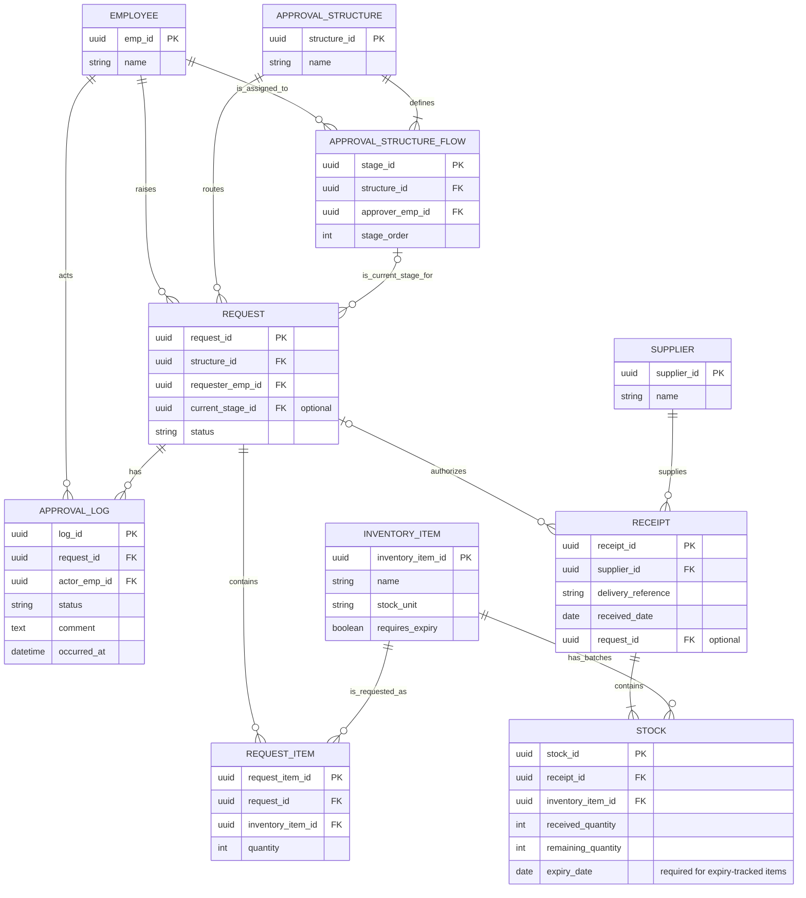

# Approval and inventory ERD

This design covers approval routing and transition history. A request uses a predefined workflow, such as requester → Approver A → Approver B. Each approver can reject the request or return it for revision. The log records status or stage changes and the comments made during those transitions.

Request items link the approval workflow to the inventory catalog. A receipt can link to an approved request and contains one stock row per received batch.

## Current diagram

## Tables and columns

PK identifies a row. FK references a row in another table.

### Employee

Identifies the people who raise requests, are assigned to stages, or perform transitions.

| Column | Type and key | Purpose |
| --- | --- | --- |
| `emp_id` | UUID, PK | Identifies the employee. |
| `name` | String | Displays the employee's name. |

### Approval structure

Defines a reusable workflow that a request can select.

| Column | Type and key | Purpose |
| --- | --- | --- |
| `structure_id` | UUID, PK | Identifies the workflow. |
| `name` | String | Labels the workflow for selection. |

### Approval structure flow

Defines one ordered stage and its assigned approver within a workflow.

| Column | Type and key | Purpose |
| --- | --- | --- |
| `stage_id` | UUID, PK | Identifies the stage. |
| `structure_id` | UUID, FK → Approval structure | Identifies the workflow that owns the stage. |
| `approver_emp_id` | UUID, FK → Employee | Identifies the employee assigned to the stage. |
| `stage_order` | Integer | Determines the stage's position. Each position is unique within its workflow. |

### Request

Stores the selected workflow and the request's current position. Its ID also links request items and any associated receipts.

| Column | Type and key | Purpose |
| --- | --- | --- |
| `request_id` | UUID, PK | Identifies the request throughout the workflow. |
| `structure_id` | UUID, FK → Approval structure | Identifies the workflow chosen for the draft. |
| `requester_emp_id` | UUID, FK → Employee | Identifies the employee who raised the request. |
| `current_stage_id` | UUID, optional FK → Approval structure flow | Identifies the stage currently responsible for the request. Empty when no approval stage is active. |
| `status` | String | Holds the current state, such as Draft, In approval, Revise, Rejected, or Approved. |

### Approval log

Stores one row per change in request status or stage. A stage comment belongs to the transition where it was made.

| Column | Type and key | Purpose |
| --- | --- | --- |
| `log_id` | UUID, PK | Identifies the transition entry. |
| `request_id` | UUID, FK → Request | Identifies which request changed. |
| `actor_emp_id` | UUID, FK → Employee | Identifies who performed the transition. |
| `status` | String | Records the request's status after the transition. |
| `comment` | Text | Holds the actor's comment for this transition, when provided. |
| `occurred_at` | Date and time | Records when the transition occurred. |

### Request item

Records one item and quantity on a purchase request.

| Column | Type and key | Purpose |
| --- | --- | --- |
| `request_item_id` | UUID, PK | Identifies the request line. |
| `request_id` | UUID, FK → Request | Identifies the request containing the line. |
| `inventory_item_id` | UUID, FK → Inventory item | Identifies the product being requested. |
| `quantity` | Integer | Records the requested quantity in the item's stock unit. Once approved, it counts toward the receiving limit for that item. |

### Inventory item

Defines a product. Create the catalog entry before requesting a new item.

| Column | Type and key | Purpose |
| --- | --- | --- |
| `inventory_item_id` | UUID, PK | Identifies the product across requests and batches. |
| `name` | String | Displays the product name. |
| `stock_unit` | String | Defines the counting unit, such as box or pair. |
| `requires_expiry` | Boolean | Indicates whether received batches need an expiry date. |

### Supplier

Identifies the company or person supplying a delivery.

| Column | Type and key | Purpose |
| --- | --- | --- |
| `supplier_id` | UUID, PK | Identifies the supplier. |
| `name` | String | Displays the supplier name. |

### Receipt

Records one delivery from a supplier.

| Column | Type and key | Purpose |
| --- | --- | --- |
| `receipt_id` | UUID, PK | Identifies the receipt. |
| `supplier_id` | UUID, FK → Supplier | Identifies who supplied the delivery. |
| `delivery_reference` | String | Identifies the delivery within that supplier's records. |
| `received_date` | Date | Records the date the goods arrived. |
| `request_id` | UUID, optional FK → Request | Links the delivery to an approved request when applicable. |

### Stock

Records one received batch. Use `stock_id` on the physical batch label.

| Column | Type and key | Purpose |
| --- | --- | --- |
| `stock_id` | UUID, PK | Identifies the batch. |
| `receipt_id` | UUID, FK → Receipt | Identifies the delivery containing the batch. |
| `inventory_item_id` | UUID, FK → Inventory item | Identifies the product in the batch. |
| `received_quantity` | Integer | Records the quantity received in the item's stock unit. |
| `remaining_quantity` | Integer | Records the quantity still on hand in the batch. |
| `expiry_date` | Date, conditionally required | Records the batch expiry date. Required for items flagged for expiry tracking. |

## Relationships

| From | To | Cardinality and meaning |
| --- | --- | --- |
| Employee | Request | An employee can raise zero or many requests. Each request has one requester. |
| Employee | Approval structure flow | An employee can be assigned to zero or many stages. Each stage has one assigned approver. |
| Employee | Approval log | An employee can perform zero or many transitions. Each entry has one actor. |
| Approval structure | Approval structure flow | A usable workflow has one or more stages. Each stage belongs to one workflow. |
| Approval structure | Request | A workflow can route zero or many requests. Each request selects one workflow. |
| Approval structure flow | Request | A stage can be current for zero or many requests. A request has zero or one current stage. |
| Request | Approval log | A request can have zero or many log entries. Each entry belongs to one request. |
| Request | Request item | A request can have zero or many lines. Each line belongs to one request. |
| Inventory item | Request item | A product can appear on zero or many request lines. Each line identifies one product. |
| Request | Receipt | An approved request can link to zero or many receipts. A receipt can link to zero or one request. |
| Supplier | Receipt | A supplier can have zero or many receipts. Each receipt has one supplier. |
| Receipt | Stock | A receipt contains one or more batches. Each batch belongs to one receipt. |
| Inventory item | Stock | A product can have zero or many batches. Each batch contains one product. |

The request's current stage must belong to its selected workflow. Save the request change and its log entry together.

Use a unique combination of supplier and delivery reference to identify duplicate deliveries. For linked receipts, compare the combined received quantity for each item against the approved balance before saving. Use received quantities for that balance and remaining quantities for stock on hand. Split batches with different expiry dates into separate stock rows.

## Approval transitions

| Actor and action | Before | After |
| --- | --- | --- |
| Requester submits | Draft, no stage | In approval, Stage 1 (A) |
| A approves | In approval, Stage 1 (A) | In approval, Stage 2 (B) |
| B requests revision from A | In approval, Stage 2 (B) | Revise, Stage 1 (A) |
| A or B rejects | In approval, current stage | Rejected, no active stage |
| B gives final approval | In approval, Stage 2 (B) | Approved, no active stage |

A's handoff to B creates a log entry with `status = In approval`. The request's `current_stage_id` changes to Stage 2. The log's status history alone cannot reconstruct the stage sequence when several stages share a status. Editing draft contents creates no approval log entry. Two decisions remain open: what the original `startempid` represents, and how a request resumes approval after it returns for revision.
