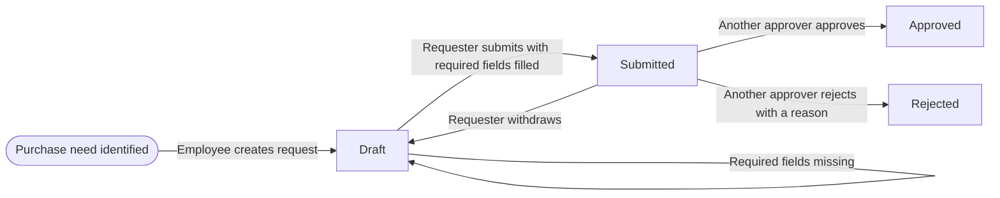
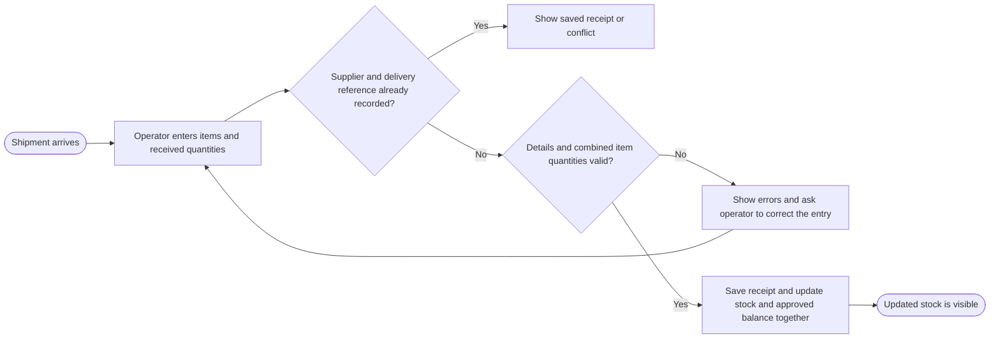
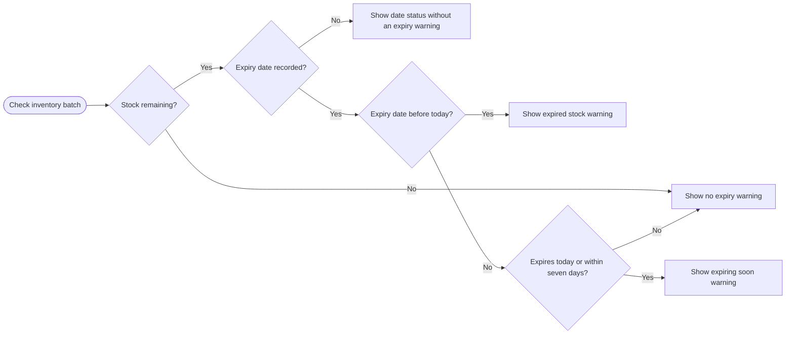

# OPSFlow — Day 02 Workflow Rules

Draft workflows for the three use cases in the [product brief](product%20brief.md).

These are proposed MVP rules. The scenarios describe expected behavior for future verification.

## Use Case 1 — Request Purchase Approval

### Workflow rules

| Decision | Proposed rule |
| --- | --- |
| Roles and permissions. Do boss and manager mean the same role? Who can create or view requests? Which approver can decide a given request? Can they decide their own request? | Boss and manager share the Approver role. Operators can create and view their own requests. Approvers can view submitted and decided requests and decide any submitted request they did not create. |
| Required information. What fields can be blank in Draft, and what must be present and valid to submit? | Drafts may be incomplete. Submission requires an item, a positive whole quantity in its stock unit, and a business reason. |
| While Submitted. Can the requester edit or withdraw the request? If so, what state does it move to? | Only the requester can withdraw a Submitted request to Draft. They can edit and resubmit from Draft. |
| After approval. What should the requester do if they discover an error or need to change the quantity? | Approval decisions stay on record. If more units are needed, submit a linked request for the additional quantity only. Reducing or replacing an approval is outside the MVP. Coordinate with the approver before buying if the original quantity was wrong. |
| After rejection. Is a reason required? Can the requester revise and resubmit the same request, or must they start a new one? | Rejection requires a reason. To try again, submit a new request referencing the rejected one. |
| Decision history. What should someone be able to see later about who acted, when, what they decided, and which request details they saw? | Record each submission, withdrawal, approval, and rejection with actor, timestamp, and resulting state. Preserve each submitted version and the rejection reason. |

If a permission, state, or validation check fails, show the reason and leave the request unchanged. If withdrawal and a decision compete, only the first successful transition applies.

### Scenarios to check

| Given this situation | Expected result |
| --- | --- |
| The requester tries to submit a draft with a required field missing. | Show the missing field and keep the request in Draft. |
| The requester enters 50 boxes and realizes after submitting that they meant 500. | Withdraw to Draft, change 50 to 500, and resubmit. |
| The approver has already approved 50 boxes when the requester spots the error. | Keep the approval for 50. If 500 total are needed, submit a linked request for 450 additional boxes. Coordinate with the approver before buying. |
| An approver tries to decide a request they created. | Block the decision and keep the request Submitted. |
| A requester wants to try again after rejection. | Submit a new linked request. Preserve the original decision and reason. |

## Use Case 2 — Record Incoming Inventory

### Workflow rules

| Decision | Proposed rule |
| --- | --- |
| Receipt details. Who can record a receipt, and what must they enter for each item? When is an expiry date required? | Operators enter the supplier, delivery reference, receipt date, and each item and quantity. Split quantities with different expiry dates into separate lines. Require expiry dates for items flagged for expiry tracking. |
| Validation. Which quantities and units are valid? What happens if any item on the receipt is invalid? | Require positive whole quantities in each item's stock unit. If any line is invalid, show its errors and save neither the receipt nor any stock changes. |
| Purchase link. Must the receipt link to an approved request? What happens when there is no request or only part of the approved quantity arrives? | Linking is optional. If linked, require an approved request and sum all receipt lines for each approved item before checking its remaining quantity. Check and deduct that balance as part of saving the receipt and updating stock, so simultaneous receipts cannot use the same balance. Leave any unused balance available for later receipts. |
| Stock update. When does stock increase? How should OPSFlow handle a duplicate receipt or a mistake discovered after saving? | Save the receipt and stock increase together. Check the supplier and delivery reference for duplicates before validating the current approved balance. Enforce uniqueness when saving so simultaneous submissions cannot add stock twice. Matching retries show the saved receipt. Different details under the same reference show a conflict. Correct saved quantities through documented batch adjustments. |
| Stock decreases. Which actions can reduce stock in the MVP, and who can perform them? | Operators record usage, disposal, or corrections against a batch and provide a reason. Reject removals that exceed available stock. |

### Scenarios to check

| Given this situation | Expected result |
| --- | --- |
| There are 20 boxes in stock and the operator records a valid receipt for 30 more. | Save one receipt and increase stock from 20 to 50. |
| The operator enters zero or a negative quantity. | Show a quantity error and leave stock unchanged. |
| Only 30 of the 50 approved boxes arrive. | Record a linked receipt for 30 and leave 20 available to receive later. |
| A receipt uses the full approved balance and the operator retries it after a timeout. | Return the original receipt. Stock increases once, even though the remaining approved balance is zero. |
| The operator reuses a receipt reference with different details. | Show a conflict and leave stock and approved balances unchanged. |
| Two batches of 30 boxes are entered on one receipt against an approval for 50. | Reject the entire receipt because 60 exceeds 50. Leave stock and the approved balance unchanged. |
| Two different receipts for 30 boxes are submitted at the same time against a balance of 50. | Save at most one receipt. After the first succeeds, reject the other because only 20 remain. |

## Use Case 3 — Identify Expiring Stock

### Workflow rules

| Decision | Proposed rule |
| --- | --- |
| What gets tracked. If two deliveries of the same item have different expiry dates, how should OPSFlow distinguish them? | Track each receipt line as a separate batch with its own expiry date and remaining quantity. |
| Date boundaries. How many days count as expiring soon? Is the cutoff day included? What status applies on the expiry date itself? | Compare dates in the warehouse time zone. Before today is Expired. Today through seven days from today, inclusive, is Expiring soon. |
| Missing dates and empty stock. How should OPSFlow handle items with no recorded expiry date or no remaining units? | Exclude empty batches. For batches with stock and no date, show Expiry date missing for items flagged for expiry tracking and Not applicable for other items. |
| Warning visibility. Who sees warnings, where do they appear, and does the MVP send notifications? | Operators and approvers see warnings on the inventory screen with the batch, expiry date, and remaining stock. Email and SMS are outside the MVP. |

### Scenarios to check

| Given this situation | Expected result |
| --- | --- |
| A batch expired yesterday and still has stock. | Show Expired. |
| A batch expires today. | Show Expiring soon. |
| A batch expires exactly at the warning cutoff. | Show Expiring soon because day seven is included. |
| Two batches of the same item expire on different dates. | Evaluate and display each batch's status separately. |
| A batch has no recorded expiry date. | With stock remaining, show Expiry date missing for expiry tracked items and Not applicable for other items. |

| A batch has zero units remaining. | Show no expiry warning. |
| A batch with stock expires eight days from today. | Show no expiry warning. |

Review the proposed rules and expected results before using them as implementation requirements.
